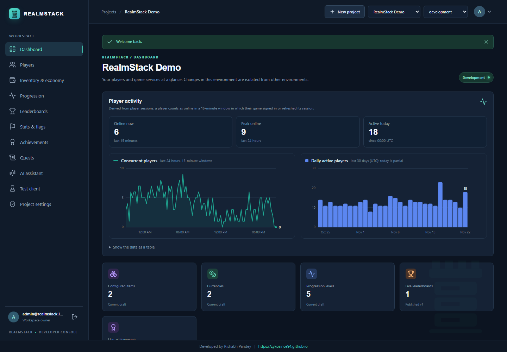
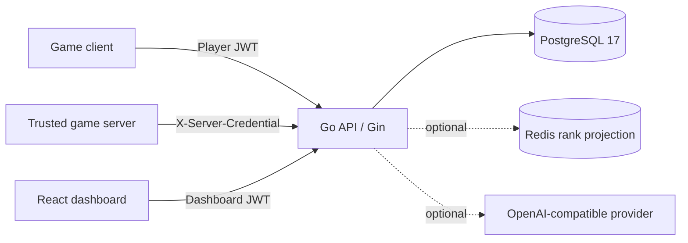
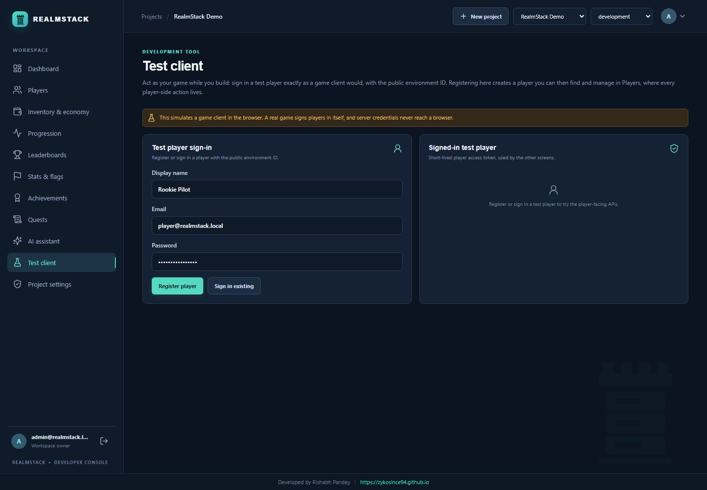

# RealmStack


**One multi-tenant API for game accounts, economy, progression, live content and moderation.**

RealmStack is a production-minded game backend written in Go and backed by PostgreSQL. It gives every game project its own isolated environment, a publishable configuration model, and the services live games keep rebuilding: identity, inventory, currency, XP, leaderboards, achievements, quests, cloud saves and bans.

The Go API is this repository. The React dashboard, player-management console, configuration editors and documentation live in the separate [RealmStack frontend repository](https://github.com/zykosince94/realmstack-frontend). repository.



[Why RealmStack](#why-realmstack) · [Tech stack](#tech-stack) · [Quick start](#quick-start) · [API model](#api-model) · [Scale](#scale-and-operations) · [AI assistant](#ai-configuration-assistant) · [Security](#security)

## Why RealmStack

- **Tenant isolation from the principal, not the payload.** Project and environment scope comes from the authenticated credential. Cross-tenant UUIDs return `404`, never data.
- **Publishable configuration.** Define items, currencies, progression, leaderboards, stats, achievements and quests in a draft. Validate it, publish an immutable version, roll back without rewriting history.
- **One goal engine.** Achievements and quests share the same nine condition types, reward application and ledger rules. Progress is derived on read; it is never stored.
- **Correct by construction.** Every value-moving mutation is idempotent, transactional and append-only. Balances and stacks change in one conditional statement. Claims pay exactly once.
- **Scale without a second source of truth.** PostgreSQL stays authoritative. Best scores and goal totals are maintained in-transaction, ledgers are partitioned, batches are savepointed, and Redis is an optional rank projection.
- **Human-in-the-loop AI.** Bring your own OpenAI-compatible key; the assistant proposes definitions, validates them like hand-written configuration, and edits only the draft. A person applies and publishes.

## Feature map

| Area | What you get |
|---|---|
| Tenancy | Projects, environments, revocable server credentials, archive instead of delete |
| Identity | Player registration/login, short-lived JWTs, rotating refresh-token families, profiles |
| Inventory | Item definitions with metadata maps, stack limits, equipment slots, atomic consume/equip |
| Economy | Currency balances, atomic credit/spend, full transaction history |
| Progression | Versioned XP curves, per-player version pinning, level calculation |
| Leaderboards | Higher/lower boards, seasons, best score, deterministic ties, rank, optional Redis projection |
| Stats & flags | Server-reported counters and set-only flags with an immutable ledger |
| Achievements | Passive goals over a closed condition set, hidden masking, one-time rewards |
| Quests | Ordered stages, chains, prerequisites, daily/weekly periods, windows, stage and completion claims |
| Cloud saves | Named JSON slots with optimistic version checks |
| Player management | Search, inspect and perform every game action from the dashboard |
| Moderation | Bans with reason, optional expiry, history, session revocation and per-instance cache |
| Activity | CCU and DAU derived from session issuance |
| AI assistant | BYOK provider settings, strict proposal validation, draft-only apply |
| Operations | Migrations, maintenance, rebuilds, verification, quotas, load-test suite |

## Tech stack

| Layer | Choice | Why it is here |
|---|---|---|
| Language | **Go 1.27** | Small static binaries, predictable latency, strong concurrency, low memory, one deploy artifact |
| HTTP | **Gin 1.10** | Mature routing and middleware, explicit handlers, easy integration tests |
| Database | **PostgreSQL 17** | ACID transactions, constraints, JSONB, partitions, advisory locks, window and aggregate queries |
| Data access | **pgx v5 + hand-written SQL** | Exact control over locks, atomic updates and partitions; no ORM surprises |
| Transactions | **`platform.Mutate`** | One place for idempotency, advisory locks, replay, conflict detection and rollback |
| Auth | **JWT HS256, bcrypt, rotating refresh tokens** | Stateless access tokens with revocable, hashed refresh families |
| Cache | **Redis (optional)** | Sorted-set leaderboard projection only; PostgreSQL remains authoritative |
| AI | **`openai-go/v3`** | Official SDK, Responses API, strict JSON Schema, compatible Chat Completions providers |
| Contract | **OpenAPI 3 + `openapi-typescript`** | One contract drives the route test, docs download and generated frontend client |
| Migrations | **Numbered SQL + advisory-locked runner** | Explicit schema, idempotent DDL, safe multi-instance startup |
| Testing | **`go test`, PostgreSQL integration tests, k6** | Real transaction behaviour and a reproducible load profile |
| Packaging | **Multi-stage Docker + Compose** | Small image, one-command demo, separate test and load stacks |
| Observability | **Structured JSON logs, request IDs, `/healthz`** | Debuggable production behaviour without logging secrets |

## Architecture



Every request resolves a principal and a project/environment scope before a handler runs. Mutations share one transaction wrapper: idempotency record, advisory lock, domain change, immutable ledger rows and derived-table updates commit together.

## Quick start

### Full dashboard + API

The integrated stack is owned by the `realmstack-frontend` repository and builds this API from a local checkout next to it, so clone both repositories into the same parent folder (`realmstack-backend/` beside `realmstack-frontend/`):

```sh
cd ../realmstack-frontend
cp .env.example .env
docker compose up -d --build --wait
```

Open the dashboard at <http://localhost:5174> and the API at <http://localhost:8080>. Health: <http://localhost:8080/healthz>.

### API only

```sh
docker compose up -d --build --wait
```

Compose project: `realmstack-backend` (`realmstack-backend-db-1`, `realmstack-backend-api-1`). It uses host port 8080, so run one demo stack at a time.

### From source

Requires Go 1.27 and PostgreSQL 17:

```sh
cp .env.example .env
# Set JWT_SECRET to at least 32 random characters.
go run ./cmd/api
```

Migrations run on startup. Set `DATABASE_DIRECT_URL` if `DATABASE_URL` goes through PgBouncer.

### Demo credentials

Seed data requires **both** `APP_ENV=local` and `DEMO_MODE=true`.

| Purpose | Value |
|---|---|
| Dashboard login | `admin@realmstack.local` / `RealmStackLocal!2026` |
| Clean-workspace login | `admin` / `RealmStackLocal!2026` (no projects) |
| Player login | `player@realmstack.local` / `PlayerLocal!2026` |
| Development public environment ID | `pub_realmstack_demo_dev` |
| Demo server credential | `rs_demo.realmstack-local-server-secret` |
| Demo content | Credits, Gems, Health Potion, Iron Sword; XP thresholds 100/300/700/1500; `global` board; achievements, quests and a cloud save |
| Demo activity | 20 crowd players with a month of session history |

These values are local-only. Do not reuse them outside a disposable environment.

### First requests

```sh
# Dashboard login
curl -s http://localhost:8080/v1/auth/login -H 'Content-Type: application/json' \
  -d '{"email":"admin@realmstack.local","password":"RealmStackLocal!2026"}'

# Player login
curl -s http://localhost:8080/v1/players/login -H 'Content-Type: application/json' \
  -d '{"public_environment_id":"pub_realmstack_demo_dev","email":"player@realmstack.local","password":"PlayerLocal!2026"}'

# Trusted grant (local demo credential only)
curl -s http://localhost:8080/v1/server/players/PLAYER_UUID/items/grant \
  -H 'X-Server-Credential: rs_demo.realmstack-local-server-secret' \
  -H 'Idempotency-Key: demo-reward-001' \
  -H 'Content-Type: application/json' \
  -d '{"item_key":"health_potion","quantity":1,"reason":"demo_reward"}'
```

### Test client

The dashboard's Test client registers or signs in a demo player exactly as a game client would, so you can exercise player-facing routes without a game build.



## API model

### Authentication

| Principal | Credential | Scope |
|---|---|---|
| Dashboard user | `Authorization: Bearer <user JWT>` | Projects and environments the user owns |
| Player | `Authorization: Bearer <player JWT>` | That player's own state |
| Trusted server | `X-Server-Credential: <prefix.secret>` | Any player in the credential's environment |
| Public | `environment_id` or `X-Public-Environment` | Registration/login and public leaderboard reads |

Dashboard access tokens live 15 minutes. The dashboard refresh token is an httpOnly, rotating cookie; player refresh tokens are opaque, hashed and rotating. Reusing a rotated token revokes its family.

### Envelopes and errors

```json
{ "data": {}, "meta": { "request_id": "..." } }
```

```json
{ "error": { "code": "INSUFFICIENT_FUNDS", "message": "...", "details": {} }, "meta": { "request_id": "..." } }
```

Validation failures are `422` with JSON-path field errors such as `achievements[2].conditions[0].stat_key`, so a client or dashboard can place the message next to the input. Status codes follow the OpenAPI contract.

### Idempotency

Value-moving mutations require `Idempotency-Key`. Keys are namespaced by actor kind (`player`, `server`, `admin`) and target player. A replay with the same normalized payload returns the original status and body; a different payload is `409`. Records expire after 30 days.

### Route groups

| Surface | Prefix | Highlights |
|---|---|---|
| Dashboard | `/v1/auth`, `/v1/projects/...` | Projects, environments, credentials, draft/publish/rollback, player admin, bans, saves, activity, AI settings |
| Player | `/v1/players/me/...` | Profile, inventory, economy, progression, stats, achievements, quests, saves |
| Trusted server | `/v1/server/...` | Grants, credits, XP, stats/flags, claims, saves, batch writes |
| Leaderboards | `/v1/leaderboards/...` | Public top-N and rank, player score submission |
| AI | `/v1/ai/settings`, `.../ai/generations` | Per-user provider settings and per-environment proposals |

**The contract is [`api/openapi.yaml`](api/openapi.yaml).** Every route is documented there, `TestOpenAPICoversEveryRoute` fails on drift in either direction, and the frontend generates its typed client from it. The dashboard also ships a human API reference.

## Configuration and correctness

Configuration is draft-first:

```text
edit definitions ──► draft ── validate ──► publish ──► immutable version
                                                         │
                                              runtime reads only this
```

- Definition edits change only the draft. The whole draft is validated on publish; failures list every field path.
- Publishing records `created_by` and creates a new progression version only when XP thresholds change.
- Rollback republishes an older version as a new version and resets the draft; history is never rewritten.
- Definitions removed from the draft are deactivated, not deleted. Ledger rows keep their meaning.
- Scored leaderboard direction/season, used stat kinds and accepted quest stage order are immutable. Use a new key for a new meaning.
- `editor_layout` stores quest-canvas positions; publishing ignores it.

Ledger tables are append-only at the database level. Corrections are compensating rows. Goal evaluation counts only `source='api'` rows, so rewards paid by a claim never complete another goal.

## Players, moderation, saves and activity

- **Player management** uses the same handlers and transaction functions as the game. Grants, spends, XP, score submissions, claims, saves and bans are all available from the dashboard; players never need a dashboard account.
- **Bans** support a reason, optional expiry and complete history. A ban revokes every refresh token in the same transaction and is enforced at login, refresh and every player-token request. Server and dashboard actions still work. Each instance caches bans and syncs changes every `BAN_SYNC_INTERVAL`.
- **Cloud saves** are named JSON slots with optimistic `expected_version` checks (`409 SAVE_VERSION_CONFLICT` with `current_version`), 10 slots, 256 KiB compacted, and no history. Player, trusted-server and dashboard routes share the handlers.
- **Activity** derives CCU and DAU from refresh-token issuance: no presence tracking on the hot path, counts only, no player identifiers.

## Scale and operations

| Concern | Implementation |
|---|---|
| Leaderboards | `leaderboard_best_scores` maintained in the submit transaction; index top-N and one indexed rank count |
| Goal totals | `player_goal_totals` written with each ledger row; achievements read totals, quests read windowed ledgers |
| Redis | Optional sorted-set projection fed by a transactional outbox; a board is served only after a full replay; PostgreSQL fallback |
| Quotas | Per-project request/write/batch limits with `429` and `Retry-After`; shared counters in PostgreSQL |
| Retention | Monthly ledger partitions; idempotency purge at 30 days; refresh-token cleanup |
| Connections | PgBouncer transaction mode, direct URL for migrations/maintenance, optional replica for lag-tolerant reads |
| Batches | `POST /v1/server/batch`, per-entry savepoints and idempotency, default 500 entries |

Operator commands:

```sh
realmstack-admin migrate
realmstack-admin maintenance
realmstack-admin rebuild-leaderboards
realmstack-admin rebuild-projection
realmstack-admin rebuild-goal-totals
realmstack-admin verify
```

`verify` compares derived data with a recomputation and exits non-zero on a mismatch. The load-test suite and traffic profile are in [`loadtest/README.md`](loadtest/README.md).

## AI configuration assistant

AI is optional and off unless `AI_ENCRYPTION_KEY` is set. Dashboard users bring their own `openai` or `openai_compatible` key; keys are encrypted with AES-256-GCM using the user ID as additional authenticated data and are write-only. A user-supplied base URL is restricted to public HTTPS addresses, re-checked on the dialled IP, and redirects are never followed (`AI_ALLOW_PRIVATE_URLS=true` is the deliberate local-server exception).

The model sees an allow-listed view of the **draft only**. Output is strict-decoded, merged into a copy of the draft and validated with the same rules as publish. A valid proposal can be applied to the draft by a person; it is never published automatically. Generations run in the background because provider calls can take minutes.

## Security

- Tenant scope comes from the principal; cross-tenant and cross-environment rows use composite foreign keys.
- Passwords use bcrypt with a dummy hash for unknown emails; refresh tokens are stored as hashes.
- Mutations are idempotent and transactional; ledgers reject `UPDATE` and `DELETE`.
- Rate-limited registration/login, per-project quotas, 1 MiB request bodies, trusted-proxy configuration.
- Structured logs include request IDs but never passwords, tokens, provider keys, prompts or generated output.
- AI provider keys are encrypted at rest and the outbound URL guard prevents SSRF.

## Testing and quality

| Command | Purpose |
|---|---|
| `gofmt -l .` | Formatting gate |
| `go vet ./...` | Static analysis |
| `go test -count=1 ./...` | Unit tests; integration tests skip without a database |
| `docker compose -f docker-compose.test.yml run --rm test` | Full suite on PostgreSQL 17 |
| `cd loadtest && docker compose run --rm k6` | Reference load profile |

CI runs the suite against PostgreSQL, then builds the API image. Integration tests use an isolated schema per test.

## Project layout

```text
cmd/api/                 startup: config, pool, migrations, demo seed, graceful shutdown
cmd/realmstack-admin/    migrate, maintenance, rebuild-*, verify, seed-load
internal/platform/       envelopes, errors, principal, Env, Mutate, tenancy, pipelining
internal/httpapi/        Gin engine, middleware/auth, routes, integration and contract tests
internal/persistence/    advisory-locked migration runner
internal/<domain>/       auth projects catalog players playeradmin bans saves activity
                         inventory economy progression leaderboards stats totals goals
                         achievements quests ai batch limits maintenance demo
migrations/              numbered SQL migrations
api/openapi.yaml         the API contract
docs/screenshots/        README screenshots
loadtest/                k6 suite and disposable multi-instance stack
```

Imports point downward only: `httpapi` → `ai` → `catalog`; `quests` → `achievements` → `goals` → `inventory`/`economy`/`progression`/`stats` → `platform`. Domain handlers embed `*platform.Env`.

## Documentation

- API contract: [`api/openapi.yaml`](api/openapi.yaml)
- Load-test method: [`loadtest/README.md`](loadtest/README.md)
- Dashboard docs: the [realmstack-frontend](../realmstack-frontend) repository, under `src/features/docs/content/`
- Self-hosting: the dashboard's **Deployment → Self-hosting** guide and `docker-compose.selfhost.yml`

## Contributing and security

See [`CONTRIBUTING.md`](CONTRIBUTING.md) for the development workflow, [`SECURITY.md`](SECURITY.md) to report a vulnerability privately, and [`CHANGELOG.md`](CHANGELOG.md) for release notes.

## License

Apache License 2.0. See [LICENSE](LICENSE) and [NOTICE](NOTICE).
